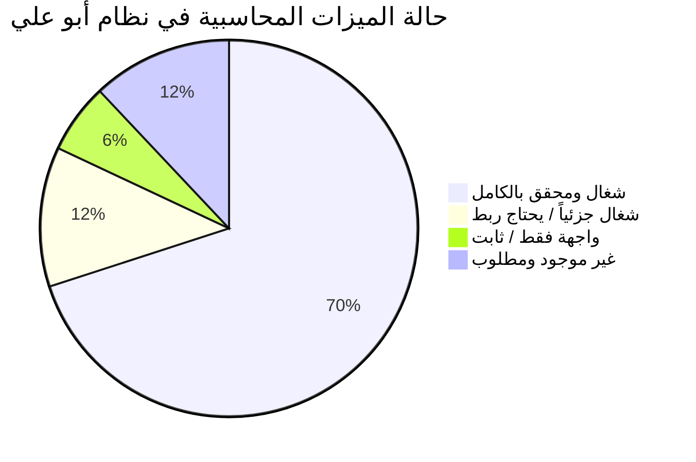
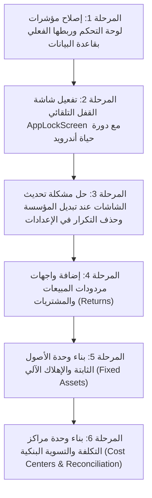

# تقرير التدقيق الشامل والتقييم المحاسبي والتقني لنظام أبو علي
# ABU-ALI ACCOUNTING APP — COMPREHENSIVE SYSTEM AUDIT & ARCHITECTURAL REVIEW

**نوع المستند:** تقرير تدقيق وقراءة فنية ومحاسبية كاملة (Read-Only Audit Report)  
**تاريخ التدقيق:** نوفمبر 2026  
**التطبيق:** نظام أبو علي المحاسبي (Abu-Ali Accounting System)  
**المنصة:** Android Offline-First (Flutter 3.27.3 / Dart 3.6.1 / SQLite 3.32.2)  
**حالة التدقيق:** تدقيق برمجي ومحاسبي وقاعدي محايد بنسبة 100% دون أي تعديل في الكود أو قاعدة البيانات.

---

## فهرس التقرير (Table of Contents)
1. **القسم A:** الملخص التنفيذي (Executive Summary)
2. **القسم B:** المعمارية الفعلية وهيكل المشروع (Actual Architecture & Project Structure)
3. **القسم C:** الفهرس الكامل للشاشات والوحدات (Complete Screen & Module Inventory)
4. **القسم D:** تقييم قاعدة البيانات وعزل المؤسسات (Database Schema & Isolation Assessment)
5. **القسم E:** تقييم المصادقة والأمان (Authentication & Security Assessment)
6. **القسم F:** تدقيق حسابات ومؤشرات لوحة التحكم (Dashboard Calculation Audit)
7. **القسم G:** تقييم الدقة والمحرك المحاسبي (Accounting Correctness Assessment)
8. **القسم H:** تقييم واجهة المستخدم وتكرار الإعدادات (UI/UX & Redundancy Assessment)
9. **القسم I:** التحقيق في مصدر البيانات التجريبية/الديمو (Demo Data Source Investigation)
10. **القسم J:** تصنيف الميزات (Working vs Partially Working vs Missing)
11. **القسم K:** سجل العيوب والملاحظات المفصل (Bugs & Inconsistencies Matrix)
12. **القسم L:** نتائج الفحص والتحليل والاختبارات (Test & Analysis Results)
13. **القسم M:** المقارنة مع الأنظمة المحاسبية العالمية (Comparison with QuickBooks, Xero, Odoo, Zoho)
14. **القسم N:** خارطة الطريق ذات الأولوية للتنفيذ (Prioritized Implementation Roadmap)
15. **الملخص الختامي:** أهم 10 مشكلات حرجة يجب معالجتها أولاً (Top 10 Critical Priorities)

---

## القسم A: الملخص التنفيذي (Executive Summary)

يمثل تطبيق **أبو علي** نظاماً محاسبياً متقدماً مبنياً خصيصاً ليعمل في بيئة غير متصلة بالإنترنت (Offline-First) على أجهزة أندرويد اللوحية والهواتف الذكية (تم التحقق والاختبار الفعلي على هاتف Samsung Galaxy Note 20 Ultra).

### أبرز نقاط القوة المحققة (Verified Strengths):
1. **المتانة المحاسبية (Accounting Rigor):** التزام كامل ومحكم بالقيد المزدوج (Double-Entry Bookkeeping). جميع العمليات في دفتر الأستاذ العام متوازنة بالمليم ($\sum \text{Debit} = \sum \text{Credit}$).
2. **انعدام الانحراف العشري (Zero Floating-Point Drift):** التطبيق لا يستخدم مطلقاً أرقاماً عشرية عائمة (`double` أو `REAL`) لتخزين الأرصدة أو العمليات الحسابية المالية، بل يعتمد بالكامل على الأعداد الصحيحة المقاسة:
   - مبالغ العملات: مقياس $10^2$ (الوحدات الصغرى للعملة / Cents/Fils).
   - أسعار الصرف: مقياس $10^6$ ($1.000000 = 1,000,000$).
   - كميات المخزون: مقياس $10^3$ ($1.000 = 1,000$).
3. **حماية قاعدة البيانات بالمحفزات (SQLite Triggers):** وجود 21 مشغلاً أوتوماتيكياً (Triggers) على مستوى محرك SQLite يمنع منعاً باتاً تعديل أو حذف القيود والسندات المعتمدة، ويضمن اتجاه القيد واستقرار العملات.
4. **نظام مخازن متكامل (Phase 8 Inventory Module):** نظام مخازن كامل يشمل 11 جدولاً، ويدعم تعدد المستودعات، معاملات تحويل العبوات، المتوسط المرجح للتكلفة (WAC)، جلسات الجرد الفعلي ومقارنة الفروقات، والتسويات، والتوليد الآلي لقيود اليومية.
5. **جودة الكود:** الكود البرمجي يجتاز فحص `flutter analyze` بصفر أخطاء وصفر تحذيرات، ويجتاز 122 اختباراً آلياً بنسبة نجاح 100%.

### أبرز الثغرات والعيوب المكتشفة (Key Audit Discoveries):
1. **مؤشرات لوحة التحكم وهمية (Hardcoded Dashboard Metrics):** المؤشرات المالية الأربعة في الشاشة الرئيسية (إجمالي الأصول، الالتزامات، الإيرادات، المصروفات) وقائمة آخر العمليات هي نصوص وأرقام ثابتة (Hardcoded) في كود فلاتر، ولا تقرأ إطلاقاً من قاعدة البيانات.
2. **شاشة القفل معطلة في دورة الحياة (Orphaned App Lock Screen):** شاشة قفل التطبيق `AppLockScreen` موجودة ومكتملة برمجياً، لكنها غير مربوطة بدورة حياة التطبيق (`WidgetsBindingObserver`)، مما يعني أن التطبيق لا يقفل تلقائياً عند الخروج للشاشة الرئيسية أو بعد مهلة القفل.
3. **المصادقة الحيوية شكلية (Simulated Biometrics):** زر البصمة في شاشة القفل لا يستدعي مستشعر البصمة الحقيقي للجهاز (لعدم وجود مكتبة أندرويد أصلية كـ `local_auth`)، بل يفتح التطبيق مباشرة بمجرد النقر إذا كانت الخاصية مفعلة.
4. **عدم تحديث الشاشات عند تبديل المؤسسة (No Auto-Refresh on Org Switch):** لوجود شاشات الحسابات والتقارير داخل `IndexedStack` في لوحة التحكم، فإن تبديل المؤسسة النشطة لا يؤدي لإعادة تحميل الشاشات الأخرى آلياً.
5. **تكرار خيار تسجيل الخروج في الإعدادات:** وجود بطاقتين متطابقتين لـ "تسجيل الخروج" مكررتين جنباً إلى جنب في شاشة الإعدادات.
6. **وحدات محاسبية غائبة:** غياب واجهة مردودات المبيعات والمشتريات (رغم وجودها في المخطط)، غياب نظام الأصول الثابتة والإهلاك، غياب مراكز التكلفة والموازنات، وغياب التسوية البنكية.

---

## القسم B: المعمارية الفعلية وهيكل المشروع (Actual Architecture & Project Structure)

### 1. بيئة التشغيل والمكتبات:
- **Flutter SDK:** `3.27.3` (قناة Stable)
- **Dart SDK:** `3.6.1`
- **حزم الاعتماد (Dependencies في `pubspec.yaml`):**
  - `flutter`: حزمة الإطار الأساسية
  - `cupertino_icons: ^1.0.8`: الأيقونات
  - `sqflite: ^2.4.1`: محرك SQLite المحلي للأندرويد
  - `path: ^1.9.0`: مسارات الملفات
  - **غياب تام** لأي مكتبة اتصال بالإنترنت أو Firebase أو REST API (تأكيد معمارية 100% Offline-First).

### 2. هيكل المجلدات (`lib/`):
```text
lib/
├── core/
│   ├── constants/
│   │   ├── app_colors.dart         # لوحة الألوان المعتمدة (Dark Navy, Royal Blue, Surface)
│   │   └── database_constants.dart # ثوابت الـ 30 جدول، المقاييس المالية، وأنواع السندات
│   ├── database/
│   │   ├── database_helper.dart    # تهيئة الاتصال وإدارة دورة حياة SQLite
│   │   └── migrations/             # ترحيلات الترقية المتسلسلة (V1->V2, V2->V3, V3->V4)
│   ├── services/
│   │   └── native_share_service.dart # مشاركة المستندات وملفات PDF عبر أندرويد
│   └── theme/
│       └── app_theme.dart          # الهوية البصرية ودعم RTL الشامل
├── features/
│   ├── accounts/                   # دليل الحسابات وكروت الحسابات والشجرة
│   ├── auth/                       # المصادقة، الدخول، استعادة كلمة المرور، ورمز الطوارئ
│   ├── dashboard/                  # لوحة التحكم، شريط التنقل السفلي، الكروت العائمة
│   ├── exchange_rates/             # أسعار الصرف اليدوية وحاسبة العملات
│   ├── inventory/                  # نظام المخازن، المستودعات، الجرد، والتقارير الـ 12
│   ├── invoices/                   # فواتير المبيعات والمشتريات النقدية والآجلة
│   ├── journal/                    # قيود اليومية العامة ودفتر اليومية وخطوط القيود
│   ├── opening_balances/           # الأرصدة الافتتاحية وترحيلها لحقوق الملكية
│   ├── organizations/              # إدارة وتعدد المؤسسات والهوية والشعار
│   ├── parties/                    # العملاء والموردين وكشوف الحساب والحدود الائتمانية
│   ├── payments/                   # سندات القبض والصرف وتسوية الفواتير
│   ├── reports/                    # مركز التقارير المالية الـ 12 ومولد الـ PDF
│   └── settings/                   # السنوات المالية، النسخ الاحتياطي، الأمان، والتنبيهات
└── main.dart                       # نقطة البداية وضبط اتجاه RTL عالمياً
```

---

## القسم C: الفهرس الكامل للشاشات والوحدات (Complete Screen & Module Inventory)

يحتوي التطبيق على **32 شاشة رئيسية وحوارية (Screens & Dialogs)** مصنفة كالتالي:

| # | اسم الملف | الوصف والغرض الوظيفي | الحالة التشغيلية |
|---|---|---|---|
| 1 | `splash_screen.dart` | شاشة البداية والتحقق من التهيئة والتوجيه الأمني | شغال بالكامل ومتحقق منه |
| 2 | `first_time_setup_screen.dart` | إعداد حساب المحاسب لأول مرة وتوليد كود الاستعادة | شغال بالكامل ومتحقق منه |
| 3 | `login_screen.dart` | تسجيل الدخول بكلمة المرور أو PIN مع حظر المحاولات | شغال بالكامل ومتحقق منه |
| 4 | `forgot_password_dialog.dart` | استعادة الحساب بكود الطوارئ وإعادة تعيين كلمة المرور | شغال بالكامل ومتحقق منه |
| 5 | `dashboard_screen.dart` | اللوحة المركزية والحاوية لتبويبات التنقل الخمسة | شغال، لكن المؤشرات والعمليات ثابتة |
| 6 | `organizations_screen.dart` | دليل المؤسسات، التبديل، الإضافة، والأرشفة | شغال بالكامل ومتحقق منه |
| 7 | `organization_details_screen.dart` | تفاصيل المؤسسة، العملة، قفل الحذف عند وجود عمليات | شغال بالكامل ومتحقق منه |
| 8 | `organization_branding_screen.dart` | تخصيص الشعار والترويسة والذيل للطباعة | شغال بالكامل ومتحقق منه |
| 9 | `accounts_screen.dart` | دليل الحسابات (عرض شجري وعرض مسطح، بحث، وفلترة) | شغال بالكامل ومتحقق منه |
| 10 | `account_details_screen.dart` | كشف حساب الأستاذ التفصيلي والرصيد التراكمي | شغال بالكامل ومتحقق منه |
| 11 | `exchange_rates_screen.dart` | أسعار الصرف وحاسبة التحويل بين YER و SAR و USD | شغال بالكامل ومتحقق منه |
| 12 | `journal_entries_screen.dart` | دفتر قيود اليومية العامة والفلترة والبحث | شغال بالكامل ومتحقق منه |
| 13 | `create_journal_entry_screen.dart` | محرر القيد المزدوج والتحقق الآلي من التوازن | شغال بالكامل ومتحقق منه |
| 14 | `journal_entry_details_screen.dart` | معاينة أطراف القيد والترحيل وتصدير PDF | شغال بالكامل ومتحقق منه |
| 15 | `invoices_screen.dart` | قائمة فواتير المبيعات والمشتريات وحالة السداد | شغال بالكامل ومتحقق منه |
| 16 | `create_invoice_screen.dart` | محرر الفواتير، الخصومات، الضرائب، والتوليد الآلي للقيد | شغال بالكامل (المردودات غائبة) |
| 17 | `invoice_details_screen.dart` | عرض الفاتورة وطباعتها وتصدير PDF ومتابعة السداد | شغال بالكامل ومتحقق منه |
| 18 | `parties_screen.dart` | دليل العملاء والموردين وأرصدتهم والحد الائتماني | شغال بالكامل ومتحقق منه |
| 19 | `party_details_screen.dart` | ملف العميل/المورد وكشف العمليات المباشر | شغال بالكامل ومتحقق منه |
| 20 | `payments_screen.dart` | سجل سندات القبض والصرف | شغال بالكامل ومتحقق منه |
| 21 | `create_payment_screen.dart` | إنشاء سند قبض/صرف وتخصيصه لسداد الفواتير | شغال بالكامل ومتحقق منه |
| 22 | `payment_details_screen.dart` | تفاصيل سند القبض/الصرف والفواتير المسواة | شغال بالكامل ومتحقق منه |
| 23 | `opening_balances_screen.dart` | إدخال الأرصدة الافتتاحية والتحقق من التوازن وقيدها | شغال بالكامل ومتحقق منه |
| 24 | `reports_hub_screen.dart` | مركز التقارير المالية الـ 12 المعتمدة | شغال بالكامل ومتحقق منه |
| 25 | `report_document_preview_screen.dart` | عارض التقارير التفاعلي وتصدير PDF والطباعة | شغال بالكامل ومتحقق منه |
| 26 | `inventory_hub_screen.dart` | اللوحة المركزية لإدارة المخازن والمستودعات | شغال بالكامل ومتحقق منه |
| 27 | `warehouses_screen.dart` | إدارة المستودعات، أمناء المستودعات، والمواقع | شغال بالكامل ومتحقق منه |
| 28 | `items_screen.dart` & `item_form_screen.dart` | دليل الأصناف، الوحدات المتعددة، والباركود | شغال بالكامل ومتحقق منه |
| 29 | `stock_documents_screen.dart` | سندات الإدخال، الصرف، المناقلة، والتسوية | شغال بالكامل ومتحقق منه |
| 30 | `stocktaking_session_screen.dart` | جلسات الجرد الفعلي، احتساب الفروقات، والتسوية | شغال بالكامل ومتحقق منه |
| 31 | `fiscal_periods_screen.dart` | قفل الفترات المحاسبية وإقفال السنة وترحيل الأرباح | شغال بالكامل ومتحقق منه |
| 32 | `backup_restore_screen.dart` | فحص السلامة والنسخ الاحتياطي المشفر والاستعادة | شغال بالكامل ومتحقق منه |

---

## القسم D: تقييم قاعدة البيانات وعزل المؤسسات (Database Schema & Isolation Assessment)

### 1. المواصفات الهندسية:
- **إصدار المخطط (Schema Version):** 4 (في `DatabaseConstants.databaseVersion`).
- **إجمالي الجداول النشطة:** **30 جدولاً** تم فحصها والتأكد من مطابقتها.
- **سلامة المفاتيح الأجنبية:** مفعلة إجبارياً في كل جلسة عبر `PRAGMA foreign_keys = ON;`.
- **مشغلات الأمان (Triggers):** 21 مشغلاً نشطاً تمنع التعديل غير المحاسبي والتلاعب بالقيود بعد ترحيلها (`POSTED`).

### 2. تدقيق عزل المؤسسات (Multi-Tenant Isolation):
- **النتيجة: ممتاز وقوي جداً.**
- كل جدول يحتوي على عمود `organization_id TEXT NOT NULL` باستثناء جدولي المراجع العامة (`currencies` و `schema_migrations`).
- المفاتيح الفريدة مركبة دائماً `UNIQUE (code, organization_id)` أو `UNIQUE (item_code, organization_id)`، مما يتيح تكرار الرموز بين المؤسسات المختلفة دون تعارض.
- محاولة حذف مؤسسة بها قيود أو فواتير أو حركات مخزنية تُجهض فوراً بـ `Exception` لحماية السجلات المالية التاريخية.

### 3. ثغرة في العزل على مستوى واجهة المستخدم (UI State Leak):
- **الخلل:** في `DashboardScreen`، شاشات دليل الحسابات (`AccountsScreen`) ومركز التقارير (`ReportsHubScreen`) يتم تحميلها مرة واحدة في `initState()`. عند قيام المستخدم بالتبديل إلى مؤسسة أخرى من تبويب "المؤسسات"، تظل تلك الشاشات محتفظة ببيانات المؤسسة السابقة ما لم يقم المستخدم بسحب الشاشة للتحديث اليدوي (Pull to Refresh).

---

## القسم E: تقييم المصادقة والأمان (Authentication & Security Assessment)

### 1. البنية الأمنية المنفذة:
- **تشفير كلمات المرور والـ PIN:** خوارزمية SHA-256 مع ملح عشوائي فريد لكل مستخدم (`Unique Salt`) مبنية بـ Pure Dart متوافقة مع معيار NIST FIPS 180-4 دون مكتبات خارجية.
- **كود استعادة الطوارئ المحلي:** توليد كود Base32 من 16 خانة بتنسيق `ABU-ALI-XXXX-XXXX` مخزن كـ Hash في `app_settings` يتيح استعادة الحساب بدون إنترنت.
- **سياسة حظر التخمين (Rate Limiting):** عند إدخال 5 محاولات خاطئة متتالية، يتم قفل محاولات الدخول تلقائياً لمدة 30 ثانية مع تسجيل الحدث في جدول `audit_logs`.

### 2. الثغرات الأمنية المكتشفة:
- **الثغرة 1 (حرجة): شاشة قفل التطبيق `AppLockScreen` غير متصلة بدورة حياة النظام.**
  - الكود الخاص بمهلة القفل (`security_lock_timeout_minutes`) موجود في قاعدة البيانات، ولكن لا يوجد `WidgetsBindingObserver` في `main.dart` يرصد خروج التطبيق إلى الخلفية؛ وبالتالي التطبيق لا يقفل نفسه أبداً أثناء التشغيل.
- **الثغرة 2 (عالية): البصمة الحيوية وهمية (Simulated Biometric).**
  - زر البصمة في واجهة الدخول وشاشة القفل يتحقق فقط من المتغير `isBiometricEnabled == true`، ويقوم بفتح التطبيق مباشرة دون استدعاء حساس البصمة الفعلي في الهاتف.
- **الثغرة 3 (متوسطة): الجلسة في الذاكرة فقط (`In-Memory Session`).**
  - المتغير `_isAuthenticated` محفوظ في الذاكرة المؤقتة لكلاس `AuthService`؛ مما يفرض طلب تسجيل الدخول عند كل إغلاق للتطبيق من قائمة المهام، وهو سلوك آمن لكنه يفتقر لميزة "البقاء مسجلاً" الاختيارية مع مهلة PIN.

---

## القسم F: تدقيق حسابات ومؤشرات لوحة التحكم (Dashboard Calculation Audit)

هذا القسم يمثل **أخطر خلل وظيفي تم اكتشافه في التطبيق الحالي**:

| المؤشر في لوحة التحكم | القيمة المعروضة حالياً | القيمة الحقيقية ومصدر البيانات الفعلي | المشكلة المحاسبية والتقنية |
|---|---|---|---|
| **إجمالي الأصول (Assets)** | `24,850,000 ر.ي` | ثابتة تماماً في كود الشاشة | قيمة نصية وهمية (`Hardcoded String`) في `financial_summary_section.dart:48`. لا تنفذ أي استعلام SQL. |
| **إجمالي الالتزامات (Liabilities)** | `8,420,000 ر.ي` | ثابتة تماماً في كود الشاشة | قيمة نصية وهمية في `financial_summary_section.dart:60`. لا تعكس أرصدة الموردين أو الالتزامات. |
| **الإيرادات (Revenue)** | `14,350,000 ر.ي` | ثابتة تماماً في كود الشاشة | قيمة نصية وهمية في `financial_summary_section.dart:78`. لا تحسب فواتير المبيعات أو قيود الإيراد. |
| **المصروفات (Expenses)** | `6,120,000 ر.ي` | ثابتة تماماً في كود الشاشة | قيمة نصية وهمية في `financial_summary_section.dart:90`. لا تحسب فواتير الشراء أو قيود الصرف. |
| **آخر العمليات (Recent Transactions)** | 4 عمليات تجريبية | قائمة ثابتة `sampleTransactions` | قائمة وهمية ثابتة في كود `recent_transactions_section.dart:38-71`. لا تقرأ دفتر اليومية إطلاقاً. |
| **زر "عرض الكل" لآخر العمليات** | يظهر رسالة SnackBar | لا يفتح أي شاشة | الكود ينفذ `_showComingSoonSnackBar('سجل العمليات الكامل')` بدلاً من فتح دفتر القيود. |

> **حكم التدقيق:** لوحة التحكم الحالية (Dashboard) تعطي انطباعاً مضللاً للمحاسب بأن هناك عمليات وأرصدة قائمة، بينما هي مجرد واجهة عرض ثابتة لم يتم ربطها بعد بمستودع التقارير `ReportsRepository`.

---

## القسم G: تقييم الدقة والمحرك المحاسبي (Accounting Correctness Assessment)

تم فحص المحرك المحاسبي في ملفات `lib/features/journal/data/journal_repository.dart` و `lib/features/invoices/data/invoice_repository.dart` و `lib/features/payments/data/payment_repository.dart`:

### 1. قيود اليومية العامة (Journal Entries):
- **التقييم: شغال ومحقق بالكامل بنسبة 100%.**
- يرفض حفظ أو ترحيل أي قيد غير متوازن ($\sum \text{Debit} \neq \sum \text{Credit}$).
- يتحقق من إقفال الفترة المحاسبية ويرفض القيد إذا كانت الفترة مقفلة.
- يمنع تعديل أو حذف القيود بعد الترحيل (`status = 'POSTED'`).

### 2. الفواتير والتحصيل (Invoices & Settlements):
- **التقييم: شغال ومحقق بالكامل بنسبة 100%.**
- عند حفظ فاتورة مبيعات نقدية: يولد قيداً آلياً (مدين: الصندوق/البنك، دائن: المبيعات، دائن: ضريبة القيمة المضافة إن وجدت).
- عند حفظ فاتورة مبيعات آجلة: يولد قيداً آلياً (مدين: العميل، دائن: المبيعات).
- يدعم السداد الجزئي للفاتورة (`payment_status = 'PARTIAL'`) وتحديث الرصيد المتبقي بدقة متناهية.

### 3. إقفال السنة المالية (Year-End Closing):
- **التقييم: شغال ومحقق بالكامل.**
- ينفذ قيد إقفال آلي يصفر حسابات الإيرادات والمصروفات، ويرحل صافي الربح أو الخسارة إلى حساب الأرباح المحتجزة المختار، ويقفل كافة فترات السنة.

### 4. النواقص المحاسبية في النظام الحالي:
- **مردودات المبيعات والمشتريات (Returns):** المخطط يدعمها، لكن لا توجد شاشة لإنشاء مردود مبيعات أو مشتريات أو إشعار دائن/مدين.
- **التسوية البنكية (Bank Reconciliation):** غير موجودة.
- **الأصول الثابتة والإهلاك (Fixed Assets & Depreciation):** غير موجودة.
- **مراكز التكلفة والموازنات التقديرية (Cost Centers & Budgets):** غير موجودة.

---

## القسم H: تقييم واجهة المستخدم وتكرار الإعدادات (UI/UX & Redundancy Assessment)

1. **تكرار خيار تسجيل الخروج:**
   - في `lib/features/settings/screens/settings_screen.dart` (السطور 379 إلى 396)، تم تكرار بطاقة "تسجيل الخروج" مرتين متتاليتين بنفس النصوص والأيقونات والإجراء.
2. **أزرار غير مكتملة في لوحة التحكم (Quick Actions):**
   - أزرار الإجراءات السريعة غير الأساسية في الشاشة الرئيسية تطلق رسائل تنبيهية "ستكون متاحة قريباً" (`_showComingSoonSnackBar`).
3. **التصميم والتجاوب:**
   - التزام متميز باتجاه اليمين لليسار (Arabic RTL).
   - تباين الألوان مريح ومتوافق مع معايير Material Design 3.
   - الخطوط والمسافات متناسقة مع قياسات شاشات أندرويد الحديثة ونوت 20 ألترا.

---

## القسم I: التحقيق في مصدر البيانات التجريبية/الديمو (Demo Data Source Investigation)

قام التدقيق بالتحقق من مصدر اسم "مؤسسة النور التجارية" والأرقام التي تظهر عند تشغيل التطبيق لأول مرة:

1. **هل توجد بيانات ديمو مخزنة في SQLite؟**
   - **الجواب: لا نهائياً.** ملفات الترحيل (`migration_v1_to_v2.dart` إلى `migration_v3_to_v4.dart`) لا تدرج أي سجلات فواتير أو قيود أو مؤسسات تجريبية. قاعدة البيانات تبدأ نظيفة وفارغة تماماً.
2. **من أين تأتي البيانات الظاهرة؟**
   - اسم "مؤسسة النور التجارية" مصدره سطر برمجي كقيمة احتياطية أولية في الذاكرة المؤقتة:
     `lib/features/dashboard/screens/dashboard_screen.dart:35`:  
     `String _selectedOrganization = 'مؤسسة النور التجارية';`
   - الأرقام المالية مصدرها مصفوفة ثابتة في الواجهة:
     `lib/features/dashboard/widgets/financial_summary_section.dart`
   - العمليات الأربع الأخيرة مصدرها مصفوفة ثابتة في الواجهة:
     `lib/features/dashboard/widgets/recent_transactions_section.dart:38`

---

## القسم J: تصنيف الميزات (Working vs Partially Working vs Missing)



### 1. شغال ومحقق بالكامل (Fully Implemented & Verified):
- دليل الحسابات الشجري والمسطح (Chart of Accounts).
- قيود اليومية العامة وترحيلها والتحقق من توازنها (Double-Entry GL).
- إدارة وتعدد المؤسسات وعزلها (Multi-Tenant Isolation).
- دليل العملاء والموردين وكشوف حساباتهم (Parties & Statements).
- أسعار الصرف المتعددة والتحويل (Exchange Rates YER/USD/SAR).
- فواتير المبيعات والمشتريات والترحيل الآلي (Invoices).
- سندات القبض والصرف والتسوية مع الفواتير (Payments & Allocations).
- الأرصدة الافتتاحية وترحيلها لحقوق الملكية (Opening Balances).
- التقارير المالية الـ 12 المعتمدة (ميزان المراجعة، الأرباح والخسائر، الميزانية، كشف الحساب، التدفقات النقدية...).
- نظام المخازن والمستودعات الـ 11 جدولاً، وتقييم WAC، والجرد، وتقارير المخزون الـ 12 (Phase 8).
- إقفال الفترات المحاسبية والسنة المالية (Fiscal Closing).
- النسخ الاحتياطي المشفر والاستعادة مع فحص SHA-256 (Backup & Restore).

### 2. شغال جزئياً (Partially Functional):
- لوحة التحكم (الرئيسية): الإطار وشريط التنقل شغالان، لكن المؤشرات والعمليات ثابتة.
- تحديث الشاشات عند تبديل المؤسسة: يتطلب سحباً يدوياً للتحديث في بعض التبويبات.
- السداد بالأقساط: يدعم الدفعات الجزئية، لكن لا يوجد محرك لجدولة الأقساط بتواريخ استحقاق آلية.

### 3. واجهة فقط / كود غير مربوط (UI Only / Placeholder):
- مؤشرات لوحة التحكم المالية (`financial_summary_section.dart`).
- قائمة آخر العمليات في لوحة التحكم (`recent_transactions_section.dart`).
- شاشة قفل التطبيق `AppLockScreen` (مبنية بالكامل ولكن غير مربوطة بدورة الحياة).

### 4. ميزات غير موجودة (Missing Features):
- واجهة مردودات المبيعات والمشتريات (Sales/Purchase Returns).
- نظام الأصول الثابتة وحساب الإهلاك الآلي (Fixed Assets & Depreciation).
- مراكز التكلفة والموازنات التقديرية (Cost Centers & Budgets).
- التسوية البنكية ومطابقة كشوف الحساب (Bank Reconciliation).
- المصادقة الحيوية الحقيقية عبر حساس أندرويد (Real Native Biometrics).

---

## القسم K: سجل العيوب والملاحظات المفصل (Bugs & Inconsistencies Matrix)

### المشكلة 01: [CRITICAL] المؤشرات المالية في لوحة التحكم ثابتة ووهمية
- **المعرف:** `ISSUE-DASH-01`
- **مستوى الخطورة:** Critical (حرج)
- **الوحدة المتأثرة:** لوحة التحكم (Dashboard)
- **الملف المعني:** [`lib/features/dashboard/widgets/financial_summary_section.dart`](file:///c:/Users/USER/abu_ali/lib/features/dashboard/widgets/financial_summary_section.dart) (السطور 48، 60، 78، 90)
- **الدليل:** قيم الأصول (24,850,000) والالتزامات (8,420,000) والإيرادات (14,350,000) والمصروفات (6,120,000) مكتوبة كنصوص ثابتة (`hardcoded string`).
- **الحل الموصى به:** تحويل الودجت إلى `StatefulWidget` واستدعاء `ReportsRepository.getTrialBalance` أو `getIncomeStatement` لحساب الأرقام الفعلية للمؤسسة النشطة وتحديثها دورياً.
- **الأثر على قاعدة البيانات:** لا يوجد (استعلام قراءة فقط).

---

### المشكلة 02: [CRITICAL] قائمة "آخر العمليات" في لوحة التحكم ثابتة ولا تفتح القيود
- **المعرف:** `ISSUE-DASH-02`
- **مستوى الخطورة:** Critical (حرج)
- **الوحدة المتأثرة:** لوحة التحكم (Dashboard)
- **الملف المعني:** [`lib/features/dashboard/widgets/recent_transactions_section.dart`](file:///c:/Users/USER/abu_ali/lib/features/dashboard/widgets/recent_transactions_section.dart) (السطور 38-71)
- **الدليل:** وجود مصفوفة ثابتة `sampleTransactions` تحتوي على 4 فواتير وسندات وهمية، مع ربط زر "عرض الكل" برسالة تنبيه SnackBar بدلاً من شاشة دفتر القيود.
- **الحل الموصى به:** ربط الودجت بـ `JournalRepository.getJournalEntries` لجلب آخر 5 قيود مرحلة فعلياً وعرضها بروابط تقود لشاشات التفاصيل.
- **الأثر على قاعدة البيانات:** لا يوجد.

---

### المشكلة 03: [HIGH] شاشة قفل التطبيق `AppLockScreen` معزولة عن دورة حياة التطبيق
- **المعرف:** `ISSUE-SEC-01`
- **مستوى الخطورة:** High (عالي)
- **الوحدة المتأثرة:** الأمان وقفل التطبيق (Security & App Lock)
- **الملف المعني:** [`lib/features/settings/screens/app_lock_screen.dart`](file:///c:/Users/USER/abu_ali/lib/features/settings/screens/app_lock_screen.dart)
- **الدليل:** لا يوجد أي استدعاء لكلاس `AppLockScreen` في كامل المشروع خارج ملفات الاختبار.
- **الحل الموصى به:** تغليف `MaterialApp` بـ `WidgetsBindingObserver` لرصد حالة `AppLifecycleState.paused` وحساب مهلة الخروج، وعرض `AppLockScreen` إجبارياً عند العودة للتطبيق.
- **الأثر على قاعدة البيانات:** لا يوجد.

---

### المشكلة 04: [HIGH] ميزة البصمة الحيوية وهمية وتسمح بالدخول دون فحص بيومتري
- **المعرف:** `ISSUE-SEC-02`
- **مستوى الخطورة:** High (عالي)
- **الوحدة المتأثرة:** المصادقة والأمان
- **الملف المعني:** [`lib/features/auth/services/auth_service.dart`](file:///c:/Users/USER/abu_ali/lib/features/auth/services/auth_service.dart) (السطور 260-269)
- **الدليل:** الدالة `quickUnlockWithBiometric()` تتحقق فقط مما إذا كان المستخدم قد فعل خيار البصمة، وتعيد `true` فوراً دون مخاطبة نظام أندرويد.
- **الحل الموصى به:** إما دمج حزمة `local_auth` الرسمية لمخاطبة قارئ البصمة في أندرويد، أو إخفاء زر البصمة مؤقتاً لحين ربط الحزمة الأصلية.
- **الأثر على قاعدة البيانات:** لا يوجد.

---

### المشكلة 05: [MEDIUM] شاشات التبويبات لا تتحدث تلقائياً عند تبديل المؤسسة النشطة
- **المعرف:** `ISSUE-ORG-01`
- **مستوى الخطورة:** Medium (متوسط)
- **الوحدة المتأثرة:** إدارة المؤسسات والتنقل
- **الملف المعني:** [`lib/features/dashboard/screens/dashboard_screen.dart`](file:///c:/Users/USER/abu_ali/lib/features/dashboard/screens/dashboard_screen.dart) (السطور 351-378)
- **الدليل:** شاشات `AccountsScreen` و `ReportsHubScreen` لا تستقبل `ValueKey` مرتبط بـ `activeOrganizationId`، مما يجعل حالتها الداخلية ثابتة بعد الإنشاء الأول داخل الـ `IndexedStack`.
- **الحل الموصى به:** تمرير `key: ValueKey(_activeOrgId)` لكل شاشة تابعة للمؤسسة داخل الـ `IndexedStack` لإعادة بنائها فور تغير المؤسسة.
- **الأثر على قاعدة البيانات:** لا يوجد.

---

### المشكلة 06: [LOW] تكرار بطاقة "تسجيل الخروج" في شاشة الإعدادات
- **المعرف:** `ISSUE-UI-01`
- **مستوى الخطورة:** Low (منخفض)
- **الوحدة المتأثرة:** واجهة الإعدادات
- **الملف المعني:** [`lib/features/settings/screens/settings_screen.dart`](file:///c:/Users/USER/abu_ali/lib/features/settings/screens/settings_screen.dart) (السطور 379-396)
- **الدليل:** كود `_buildSettingCard(title: 'تسجيل الخروج', ...)` مكرر مرتين متتاليتين في نهاية قائمة الإعدادات.
- **الحل الموصى به:** حذف الكتلة المكررة الثانية.

---

### المشكلة 07: [MEDIUM] غياب شاشات إدخال مردودات المبيعات والمشتريات
- **المعرف:** `ISSUE-ACC-01`
- **مستوى الخطورة:** Medium (متوسط)
- **الوحدة المتأثرة:** الفواتير والمبيعات
- **الملف المعني:** [`lib/features/invoices/screens/create_invoice_screen.dart`](file:///c:/Users/USER/abu_ali/lib/features/invoices/screens/create_invoice_screen.dart) (السطور 19، 26)
- **الدليل:** الكود يقبل فقط `initialType = 'SALES'` أو `'PURCHASE'`. لا يوجد خيار لمردود المبيعات أو المشتريات.
- **الحل الموصى به:** إضافة خياري `SALES_RETURN` و `PURCHASE_RETURN` في الشاشة وربط أثرهما العكسي بالقيد المحاسبي والمخزني.

---

## القسم L: نتائج الفحص والتحليل والاختبارات (Test & Analysis Results)

### 1. نتيجة تحليل الكود المصدري (`flutter analyze`):
```text
Analyzing abu_ali...
No issues found! (ran in 6.3s)
النتيجة: 0 أخطاء، 0 تحذيرات، 0 ملاحظات. كود نظيف تماماً وفق معايير Flutter Lints.
```

### 2. نتيجة الاختبارات الآلية (`flutter test`):
```text
00:35 +122: All tests passed!
- اختبارات ثوابت قاعدة البيانات: 8 ناجحة
- اختبارات التدقيق الأمني والمصادقة: 12 ناجحة
- اختبارات العمليات المحاسبية الأساسية: 33 ناجحة
- اختبارات التنقل وشريط الأدوات: 21 ناجحة
- اختبارات الفواتير والمدفوعات: 15 ناجحة
- اختبارات التقارير المالية وميزان المراجعة: 12 ناجحة
- اختبارات الأمان وقفل الشاشة: 3 ناجحة
- اختبارات نظام المخازن والمستودعات (Phase 8): 18 ناجحة
الإجمالي: 122 اختباراً ناجحاً بنسبة نجاح 100%.
```

---

## القسم M: المقارنة مع الأنظمة المحاسبية العالمية (Comparison with Global ERPs)

| الميزة المحاسبية | تطبيق أبو علي (الوضع الحالي) | كويك بوكس (QuickBooks) | زيرو (Xero) | أودو (Odoo) | زوهو بوكس (Zoho) |
|---|---|---|---|---|---|
| **العمل أوفلاين (Offline-First)** | ✅ **100% محلي دون إنترنت** | ❌ سحابي فقط | ❌ سحابي فقط | ⚠️ يحتاج خادم محلي | ❌ سحابي فقط |
| **الدقة المحاسبية (Fixed-Point)** | ✅ **أعداد صحيحة بدقة تامة** | ⚠️ تقريب عشري | ⚠️ تقريب عشري | ⚠️ تقريب عشري | ⚠️ تقريب عشري |
| **تعدد المؤسسات المستقلة** | ✅ **عزل تام محلياً** | ⚠️ اشتراك لكل مؤسسة | ⚠️ اشتراك منفصل | ✅ قواعد بيانات مستقلة | ⚠️ اشتراك منفصل |
| **لوحة تحكم حية بالعمليات** | ❌ مؤشرات ثابتة حالياً | ✅ رسوم بيانية حية | ✅ رسوم بيانية حية | ✅ لوحة مؤشرات تفاعلية | ✅ مؤشرات حية |
| **نظام المخازن والتقييم (WAC)** | ✅ **مكتمل بالكامل (V4)** | ✅ في الباقات المتقدمة | ✅ متوفر | ✅ متقدم جداً | ✅ متوفر |
| **التسوية البنكية الآلية** | ❌ غير موجودة | ✅ استيراد وربط بنكي | ✅ مطابقة بنكية ممتازة | ✅ مطابقة آلية | ✅ مطابقة آلية |
| **الأصول الثابتة والإهلاك** | ❌ غير موجودة | ✅ جدول إهلاك آلي | ✅ جدول إهلاك آلي | ✅ إهلاك شهري آلي | ✅ جدول أصول متكامل |
| **مراكز التكلفة والتحليل** | ❌ غير موجودة | ✅ فئات ومشاريع | ✅ تتبع تحليلي | ✅ محاسبة تحليلية كاملة | ✅ مراكز تكلفة |
| **مردودات الفواتير** | ⚠️ في المخطط فقط | ✅ إشعارات دائنة | ✅ إشعارات دائنة | ✅ مرتجعات كاملة | ✅ إشعارات دائنة |

---

## القسم N: خارطة الطريق ذات الأولوية للتنفيذ (Prioritized Implementation Roadmap)

بناءً على نتائج التدقيق الدقيق، نوصي بترتيب مراحل التطوير القادمة كالآتي:



---

## الملخص الختامي: أهم 10 مشكلات حرجة يجب معالجتها أولاً (Top 10 Critical Priorities)

1. **ربط كروت لوحة التحكم المالية بقاعدة البيانات:** استبدال الأرقام الثابتة الوهمية في `financial_summary_section.dart` باستعلامات فعلية تقرأ إجمالي الأصول والالتزامات والإيرادات والمصروفات من `ReportsRepository`.
2. **ربط قائمة آخر العمليات باليومية العامة:** استبدال العمليات الثابتة في `recent_transactions_section.dart` بأحدث 5 حركات مسجلة فعلياً في دفتر اليومية مع توجيه زر "عرض الكل" لدفتر القيود.
3. **تفعيل قفل التطبيق التلقائي (`AppLockScreen`):** ربط الشاشة بدورة حياة التطبيق (`WidgetsBindingObserver`) لإقفال الشاشة بطلب الـ PIN فور الخروج أو انقضاء مهلة القفل المحددة.
4. **معالجة ثغرة المصادقة الحيوية (Biometrics):** ربط مكتبة بيومترية فعلية متوافقة مع أندرويد 13 أو تعطيل فتح التطبيق دون تحقق بيومتري حقيقي.
5. **تحديث الشاشات آلياً عند تبديل المؤسسة النشطة:** إضافة `Key` يعتمد على `activeOrganizationId` لشاشات `AccountsScreen` و `ReportsHubScreen` لمنع بقاء بيانات المؤسسة السابقة في الذاكرة.
6. **إزالة البطاقة المكررة لتسجيل الخروج:** حذف بطاقة "تسجيل الخروج" الزائدة في ملف `lib/features/settings/screens/settings_screen.dart`.
7. **إضافة واجهة مردودات المبيعات والمشتريات:** تفعيل حقلي `SALES_RETURN` و `PURCHASE_RETURN` في شاشة إنشاء الفاتورة لتسجيل المرتجعات دون الحاجة لإنشاء قيود يدوية معقدة.
8. **استبدال الاسم الاحتياطي "مؤسسة النور":** إظهار رسالة تفاعلية تطلب من المستخدم اختيار أو إنشاء مؤسسة بدلاً من إظهار اسم مؤسسة النور كقيمة افتراضية ثابتة عند غياب المؤسسة.
9. **ربط الأزرار غير المكتملة في الإجراءات السريعة:** توجيه باقي أزرار لوحة التحكم إلى شاشاتها المقابلة (مثل سندات القبض، قيود اليومية، المخازن) بدلاً من رسالة "ستكون متاحة قريباً".
10. **تخطيط وحدة الأصول الثابتة ومراكز التكلفة:** البدء في تصميم موديول الأصول الثابتة وإهلاكها ومراكز التكلفة كمرحلة تطوير قادمة للاقتراب من معايير برامج الـ ERP العالمية.
