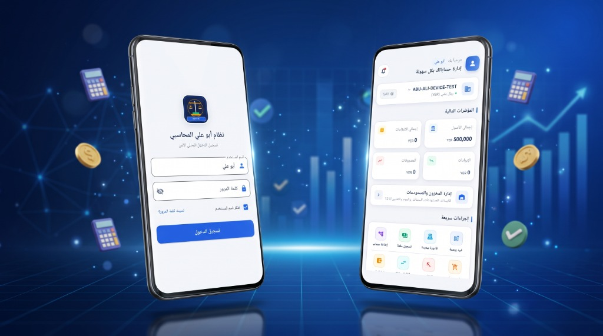
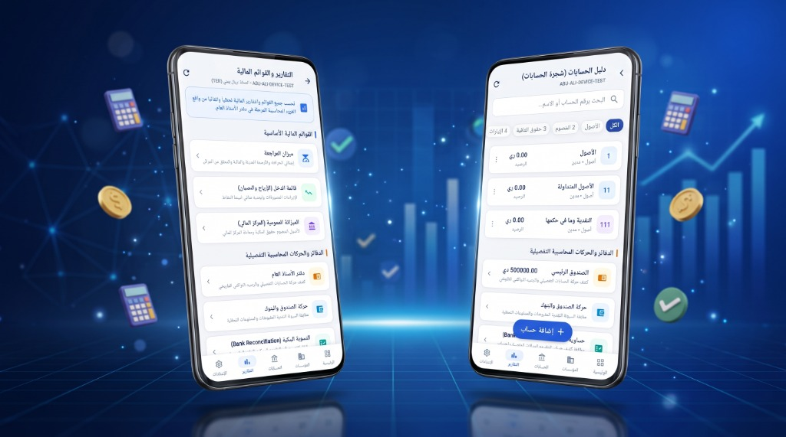

# 🏢 نظام أبو علي المحاسبي — Abu‑Ali ERP

<p align="center">
  
  
</p>

<p align="center">
  <b>نظام محاسبي وإدارة مخزون متكامل مبني بتقنية Flutter للأجهزة الذكية</b><br>
  <b>Comprehensive Accounting & Inventory Management System Built with Flutter</b>
</p>

---

## 🌐 اللغات / Languages
- [العربية](#-عربي)
- [English](#-english)

---

<a name="-عربي"></a>
## 🇸🇦 عربي

### 📖 نبذة عن المشروع
**نظام أبو علي المحاسبي (Abu-Ali ERP)** هو تطبيق محاسبي وإداري متكامل مصمم للشركات والمؤسسات المتوسطة والصغيرة. يتميز النظام بالعمل بالكامل محلياً (Offline-First) مع قاعدة بيانات SQLite مشفرة ومؤمنة، ويدعم تعدد المؤسسات المستقلة، شجرة الحسابات، قيود اليومية، الفواتير، سندات القبض والصرف، إدارة المخزون، والتقارير المالية الختامية وتوليد تقارير PDF باللغة العربية.

### 📸 واجهات التطبيق
| شاشة تسجيل الدخول واللوحة الرئيسية | دليل الحسابات والتقارير المالية |
|:---:|:---:|
|  |  |

### 🚀 أبرز المميزات المدعومة
- **إدارة مؤسسات متعددة:** إنشاء مؤسسات مستقلة، حفظ الشعارات، والتبديل السلس بينها مع عزل تام للبيانات.
- **شجرة حسابات احترافية:** تصنيف هرمي (أصول، خصوم، حقوق ملكية، إيرادات، مصروفات) مع أرصدة افتتاحية.
- **العمليات المالية والمحاسبية:**
  - قيود يومية مزدوجة مع التحقق التلقائي من التوازن (مدين = دائن).
  - سندات قبض وسندات صرف نقدية وبنكية وربطها بالفواتير.
  - تحويلات نقدية وبنكية بين الخزائن والحسابات.
- **المبيعات والمشتريات:** فواتير مبيعات وفواتير مشتريات مع معاينة وتصدير PDF باللغة العربية.
- **إدارة المخزون والمستودعات:** تصنيفات، وحدات قياس، حركات المخزون (وارد / صادر / جرد) وتكلفة متوسط مرجح.
- **التقارير المالية الختامية:**
  - ميزان المراجعة (Trial Balance).
  - دفتر الأستاذ العام (General Ledger).
  - قائمة الدخل والأرباح والخسائر (Income Statement).
  - الميزانية العمومية والمركز المالي (Balance Sheet).
  - حركة النقدية والبنوك ومطابقة الحسابات.
- **الأمان والنسخ الاحتياطي:** قفل التطبيق بكلمة مرور، رمز استرداد الحساب، والنسخ الاحتياطي المضغوط لقاعدة البيانات مع إمكانية الاستعادة.

### 🛠️ البنية التقنية (Tech Stack)
- **Framework:** Flutter (Channel stable, 3.24+)
- **Language:** Dart 3.5+
- **Database:** SQLite (`sqflite`) with schema migration support (V1 -> V4)
- **State Management & Architecture:** Layered Architecture (Clean Architecture - Data / Models / Repositories / Screens)
- **PDF Engine:** Custom RTL/Arabic PDF reporting engine using `pdf` & `printing` with Arabic fonts (`NotoNaskhArabic`, `tahoma`).

---

<a name="-english"></a>
## 🇬🇧 English

### 📖 Overview
**Abu-Ali ERP** is a professional, offline-first accounting and ERP solution tailored for small and medium enterprises. Built from the ground up using Flutter, it features full multi-tenancy (multi-organization), standard double-entry bookkeeping, invoicing, inventory tracking, financial statements, and native Arabic PDF generation.

### 🌟 Key Capabilities & Feature Matrix

| Category | Feature | Description | Implementation Status |
|----------|---------|-------------|:---------------------:|
| **Organization** | Multi-Organization | Create, switch, and manage independent companies | **WORKING** |
| **Organization** | Data Isolation | Complete partition of financial data per company | **WORKING** |
| **Accounting** | Chart of Accounts | 4-level hierarchical account tree | **WORKING** |
| **Accounting** | Journal Entries | Double-entry journals with validation | **WORKING** |
| **Accounting** | Cash & Bank | Cash registers, bank accounts & transfers | **WORKING** |
| **Accounting** | Opening Balances | Fiscal opening balance configuration | **WORKING** |
| **Invoicing** | Sales & Purchases | Invoices with line items, tax, and discounts | **WORKING** |
| **Invoicing** | Payments & Receipts | Cash/bank vouchers linked to invoices | **WORKING** |
| **Invoicing** | PDF Export | High-quality Arabic PDF invoices | **WORKING** |
| **Inventory** | Products & Units | Item directory, categories, and measurement units | **WORKING** |
| **Inventory** | Warehouses & Stock | Stock movements, inward/outward, stock count | **WORKING** |
| **Reports** | Trial Balance | Real-time debit/credit verification | **WORKING** |
| **Reports** | General Ledger | Comprehensive account transaction history | **WORKING** |
| **Reports** | Income Statement | Revenue, expenses, and net profit/loss | **WORKING** |
| **Reports** | Balance Sheet | Assets, liabilities, and equity structure | **WORKING** |
| **Reports** | Cash & Bank Flow | Cash flow statements and bank reconciliation | **WORKING** |
| **Security** | Authentication | Password authentication, recovery code, app lock | **WORKING** |
| **Backup** | Local Backup | Compressed encrypted database backup & restore | **WORKING** |

---

## 📂 Project Architecture / هيكلية المشروع

```text
abu_ali/
├── android/                 # Android native platform code
├── assets/                  # Arabic typography fonts & graphic assets
│   ├── fonts/               # NotoNaskhArabic, Tahoma for PDF rendering
│   └── images/              # App branding and icons
├── lib/                     # Application source code
│   ├── core/                # Core utilities, theme, and SQLite DB migrations
│   │   ├── constants/       # App colors, database contracts & tables
│   │   ├── database/        # DatabaseHelper, migrations v1 to v4
│   │   ├── services/        # Native share & platform services
│   │   ├── theme/           # Design system & Arabic typography
│   │   └── utils/           # Currency, date, and number formatters
│   ├── features/            # Feature-driven modular structure
│   │   ├── accounts/        # Chart of accounts, banks, transfers
│   │   ├── auth/            # Login, security code, lock screen
│   │   ├── dashboard/       # Executive summary & quick actions
│   │   ├── inventory/       # Products, categories, warehouses, stock count
│   │   ├── invoices/        # Sales & purchase invoicing
│   │   ├── journal/         # Double-entry manual journal entries
│   │   ├── organization/    # Multi-tenant organization manager
│   │   ├── parties/         # Customers and suppliers management
│   │   ├── payments/        # Receipt & payment vouchers
│   │   ├── reports/         # Financial statements & Arabic PDF generator
│   │   └── settings/        # Audit logs, backup/restore, security settings
│   └── main.dart            # App bootstrap & service initialization
├── screenshots/             # Application visual previews
├── test/                    # Comprehensive unit & widget test suite (136 tests)
├── pubspec.yaml             # Flutter dependencies declaration
└── README.md                # Documentation & Getting Started guide
```

---

## ⚡ Getting Started & Installation / التثبيت والتشغيل

### Prerequisites / المتطلبات
- [Flutter SDK](https://flutter.dev/docs/get-started/install) (version 3.24 or newer)
- Android SDK (API 34 / Android 14 recommended)
- Java Development Kit (JDK 17)

### Step-by-Step Setup / خطوات الإعداد

1. **Clone the repository / استنساخ المستودع:**
   ```bash
   git clone https://github.com/ENG-Ebraheem/abu-ali-erp.git
   cd abu-ali-erp
   ```

2. **Install Flutter packages / تثبيت الحزم:**
   ```bash
   flutter pub get
   ```

3. **Verify environment / فحص البيئة:**
   ```bash
   flutter doctor
   ```

4. **Run static analysis / فحص جودة الكود:**
   ```bash
   flutter analyze
   ```

5. **Run test suite / تشغيل الاختبارات:**
   ```bash
   flutter test
   ```
   *(All 136 automated tests should pass)*

6. **Run on Device or Emulator / تشغيل التطبيق:**
   ```bash
   flutter run
   ```

7. **Build Release APK / بناء حزمة الإنتاج:**
   ```bash
   flutter build apk --release
   ```
   The generated APK will be available at:
   `build/app/outputs/flutter-apk/app-release.apk`

---

## 🔒 Security & Exclusions Notice / إشعار الأمان والاستثناءات

This repository is curated to maintain clean open-source standards:
- Generated build directories (`build/`, `.dart_tool/`) are strictly excluded.
- User data, real transactions, and active SQLite database files (`*.sqlite`, `*.db`) are excluded.
- Private keystores, passwords, and sensitive API credentials are not committed.

---

## 📄 License / الترخيص

This project is proprietary software developed for business operations. Please consult the repository owner for licensing terms, permissions, and commercial usage.

---

**Developed with ❤️ by Eng. Ebraheem**
